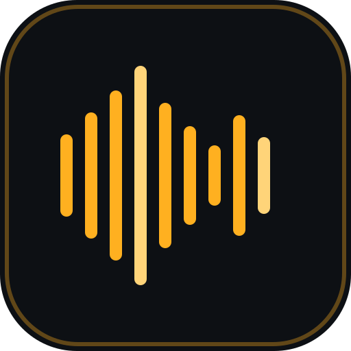
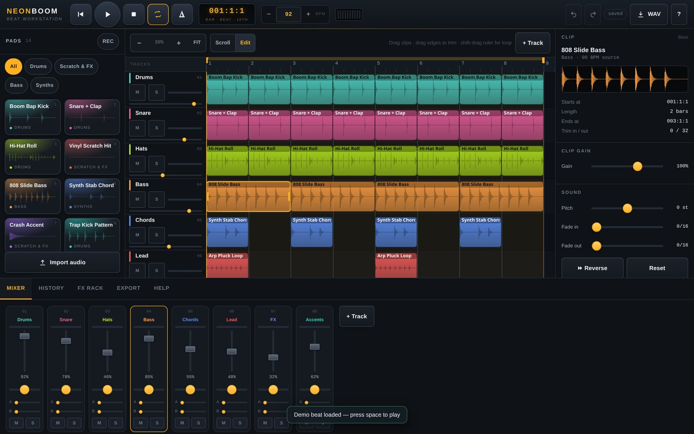
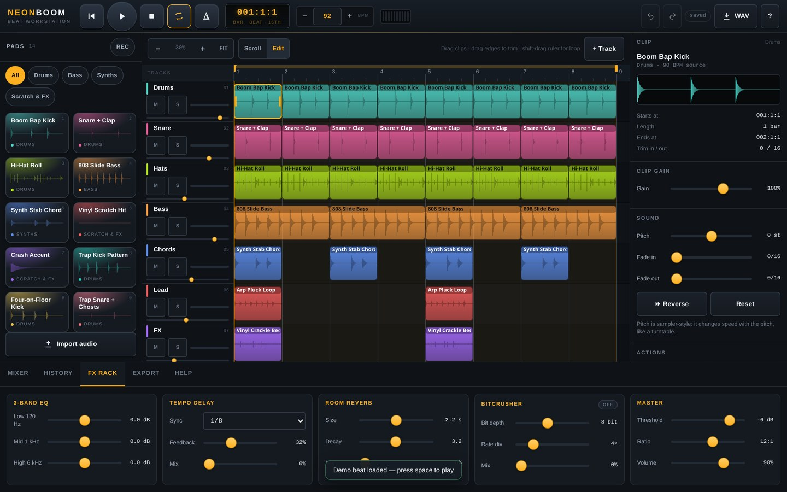
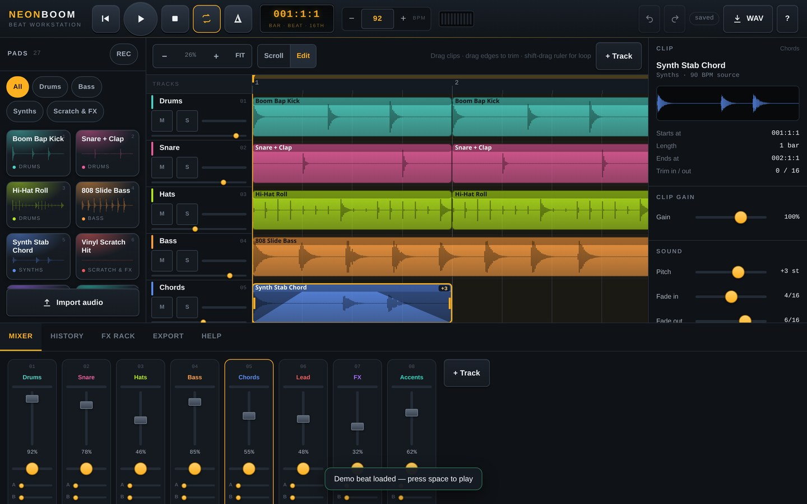
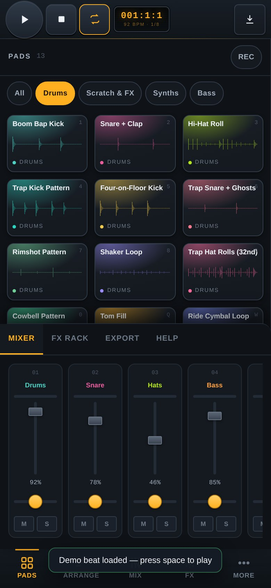
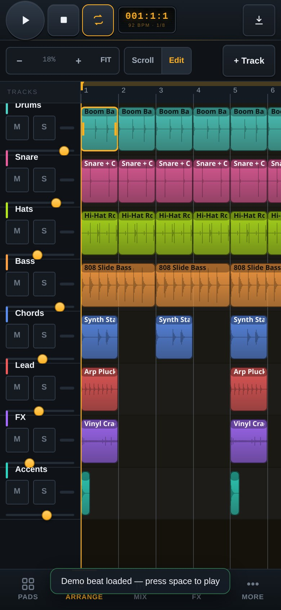
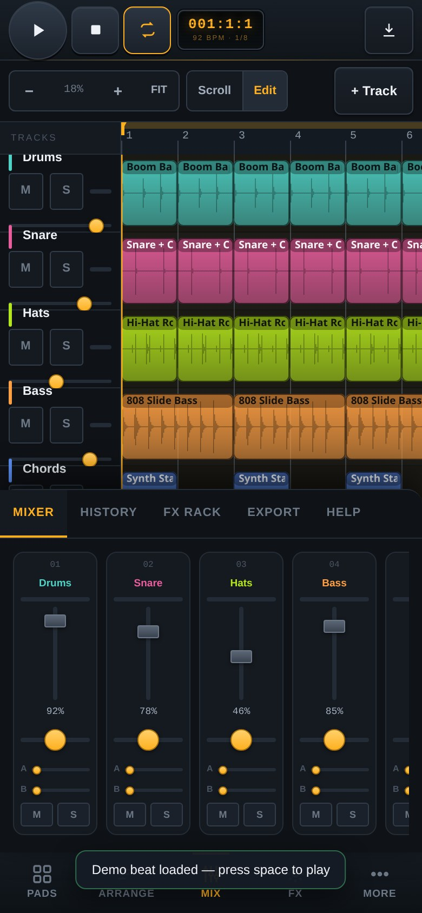

<div align="center">



# NEONBOOM

**A beat workstation that lives in a browser tab.**
Twenty-seven loops are synthesised on your device at boot — nothing to download, no account, no upload, no server.

[](https://drsamonline.github.io/neonboom/)
[](https://github.com/drsamonline/neonboom/releases/latest)

[](LICENSE)
[](CHANGELOG.md)
[](manifest.webmanifest)
[](#architecture)
[](dist/neonboom.html)
[](#testing)
[](https://github.com/drsamonline/neonboom/actions/workflows/test.yml)
[](https://github.com/drsamonline/neonboom/actions/workflows/pages.yml)
[](https://github.com/drsamonline/neonboom/stargazers)
[](https://github.com/sponsors/drsamonline)



<sub>Desktop · pad grid, arrangement, clip inspector, mixer</sub>

</div>

---

## Why this exists

Most browser music toys are a page of buttons wired to an audio tag. NEONBOOM is the other thing: a small DAW-shaped instrument with a real scheduler, real FX, real export — and it still opens instantly, works on a phone, and keeps working when the network is gone.

| | |
|---|---|
| ⚡ **Fast** | Loops are rendered once and cached in IndexedDB as 16-bit mono, so a warm start is a memory copy: **~4.7 s cold → ~1.6 s warm**, with the priority half ready before the veil lifts. |
| 🎯 **Sample-accurate** | A look-ahead scheduler queues 180 ms of audio at a time, so loop points land on the clock instead of on a `setTimeout`, tempo changes apply while rolling, and a 64-bar project never builds hundreds of nodes up front. |
| 📦 **Optional pack** | A separate 6.9 MB zip of the same 27 loops, rendered by the app itself. Bundled builds load it automatically; on the web it is a button. The core file never grows. |
| 🧰 **Templates** | Boom Bap, Trap, House or an empty grid — built from the same loops, with mixer levels and sends already set. |
| 📈 **Automation** | Per-track level and pan envelopes. Press **A** on a track, click to add points, drag to move, alt-click to remove. Played and exported |
| ✂️ **Clip editor** | Drag the trim handles on the full waveform, normalise, fit to 1 or 2 bars, halve, reset. Non-destructive — undo covers all of it. |
| 🖱 **Multi-select** | Shift-click or drag a marquee, then move, nudge, quantise, duplicate or delete the whole selection at once. |
| ♿ **Accessible** | Colour-blind-safe palette, larger-text mode, 40 px+ targets, reduced-motion aware, keyboard-first, and transport/clip changes announced to screen readers. |
| 🎛 **Pads** | 27 synthesised loops as waveform tiles. Tap to audition, arm REC to drop one at the playhead, or drag a pad onto the timeline. |
| 🎚 **Arrangement** | Canvas timeline: drag to move, drag edges to trim, alt-drag to duplicate, split, nudge, quantise, snap 1/16 – 1/4 bar, loop region with draggable handles. |
| 🎹 **Mixer** | Fader, pan, mute, solo and a live level meter on every strip, plus a master meter. |
| 🎛 **FX rack** | 3-band EQ · tempo-synced delay · convolution reverb · bitcrusher · limiter. |
| 💾 **Export** | 16-bit WAV of the arrangement or just the loop region, or **stems** — one WAV per track, zipped with a dependency-free ZIP writer. |
| 🎚 **Clip sound** | Per-clip **pitch (±12 st)**, **reverse**, **fade in / out** envelopes, gain, and project **swing** — all honoured by playback *and* export. |
| 🔌 **Offline** | Service worker + installable PWA, plus a **single 190 KB HTML file** that runs from `file://` with zero requests. |
| 📱 **Responsive** | Three separately designed layouts: desktop (3 columns), tablet (2), phone (tab bar + bottom sheets, 40 px targets, long-press actions). |
| ↩️ **Safe** | 80-step undo/redo with a visible history, autosave to IndexedDB every 650 ms, project files you can save and reopen. |

---

## Try it

| | |
|---|---|
| **▶ Live app** | https://drsamonline.github.io/neonboom/ |
| **Landing page** | https://drsamonline.github.io/neonboom/docs/ |
| **One file, no server** | [`dist/neonboom.html`](dist/neonboom.html) — double-click it |
| **Releases** | [Windows · macOS · Linux · Android · standalone HTML](https://github.com/drsamonline/neonboom/releases/latest) |

### Downloads

| File | What it is |
|---|---|
| `neonboom.html` | The whole app in one ~192 KB file. Double-click it; runs offline from `file://`, zero network requests. |
| `NEONBOOM.Setup.*.exe` | Windows installer (x64, NSIS) |
| `NEONBOOM-*.dmg` | macOS (Intel and Apple Silicon) |
| `NEONBOOM-*.AppImage` · `*.deb` | Linux portable and Debian/Ubuntu packages |
| `app-debug.apk` | Android **debug** build — unsigned; allow "unknown sources" to install |
| `neonboom-pack-v1.zip` | **Optional** 6.9 MB pack of the 27 loops (mono 16-bit WAV). Skips synthesis on a cold start; the app works without it. |
| `neonboom-source.zip` | Modular source, tests, docs and wrappers |

Desktop and Android binaries are built by GitHub Actions from the tag and are unsigned, so the OS
warns on first launch. The web app is the product; everything else is a convenience wrapper.

```bash
git clone https://github.com/drsamonline/neonboom.git
cd neonboom
npx serve .          # or: python3 -m http.server 8080
```

Opening `index.html` straight from disk also works — the app is plain classic scripts, not ES modules — but the service worker and install prompt need `http(s)`.

---

## Screenshots

<div align="center">

| Pads + FX rack | Clip inspector |
|---|---|
|  |  |

| Phone · pads | Phone · arrange | Phone · mixer |
|---|---|---|
|  |  |  |

</div>

---

## Keyboard

| Action | Key | Action | Key |
|---|---|---|---|
| Play / pause | <kbd>Space</kbd> | Duplicate clip | <kbd>Ctrl</kbd> <kbd>D</kbd> |
| Rewind | <kbd>R</kbd> | Nudge clip | <kbd>←</kbd> <kbd>→</kbd> |
| Loop on / off | <kbd>L</kbd> | Quantise | <kbd>Q</kbd> |
| Metronome | <kbd>K</kbd> | Undo / redo | <kbd>Ctrl</kbd> <kbd>Z</kbd> / <kbd>Ctrl</kbd> <kbd>Y</kbd> |
| Split at playhead | <kbd>S</kbd> | Zoom / fit | <kbd>−</kbd> <kbd>+</kbd> <kbd>F</kbd> |
| Delete clip | <kbd>Del</kbd> | Save project file | <kbd>Ctrl</kbd> <kbd>S</kbd> |
| Copy / cut / paste clip | <kbd>Ctrl</kbd> <kbd>C</kbd> / <kbd>X</kbd> / <kbd>V</kbd> | History panel | drawer → *History* |
| Add to selection | <kbd>Shift</kbd> + click | Marquee select | drag over empty lane |
| Mute track | <kbd>M</kbd> | Audition pads | <kbd>1</kbd>…<kbd>0</kbd> <kbd>Q</kbd> <kbd>W</kbd> |

On a phone: tap a pad to hear it, tap a clip to select it, **long-press** a clip for duplicate / split / quantise / delete, and use the **Scroll / Edit** switch above the timeline to choose between panning and dragging.

---

## Architecture

No framework, no bundler, no dependencies. Each file is an IIFE that hangs a module off `window.NB`, loaded in dependency order.

```
index.html                 shell markup
manifest.webmanifest       PWA metadata
sw.js                      cache-first service worker
assets/css/tokens.css      design tokens (colour, type, geometry)
assets/css/app.css         layout + components + responsive rules
assets/img/                icons
src/core/util.js           helpers, musical grid math, toasts
src/core/project.js        sample registry, project state, undo/redo, IndexedDB, loop cache, project files, demo beat
src/core/looppack.js       optional pack: zip reader, decode, install
src/core/templates.js      Boom Bap / Trap / House / empty starting points
src/core/transport.js      playback clock, look-ahead scheduler, loop, metronome, live refresh
src/audio/synth.js         procedural loop synthesis (27 generators)
src/audio/engine.js        AudioContext, master FX chain, track buses, meters, click, preview
src/audio/schedule.js      clip → scheduled node (pitch, reverse, fades, swing) shared by live + export
src/audio/wav.js           16-bit WAV encoder + offline render
src/ui/timeline.js         canvas arrangement: rendering, pointer/touch editing, zoom
src/ui/pads.js             pad grid
src/ui/mixer.js            mixer strips
src/ui/fx.js               FX rack + snapshot() for export
src/ui/inspector.js        context panel
src/ui/shell.js            transport bar, drawer, sheets, keyboard, import/export
src/app.js                 boot sequence
scripts/build-standalone.mjs   inlines everything into dist/neonboom.html
electron/                  desktop wrapper (Windows / macOS / Linux)
capacitor.config.json      Android wrapper
.github/workflows/         Pages deploy, release builds, Android APK
```

**Design notes that matter**

- The timeline draws into a **viewport-sized** canvas, not a project-sized one. A 64-bar project at 400 % zoom would need a 74 000 px canvas — past the browser limit, and it silently renders blank. Native scrolling is kept with a spacer div; the canvas is translated to the scroll origin.
- Playback position is derived from the `AudioContext` clock, never from `requestAnimationFrame`, so tempo changes and long sessions do not drift.
- Mute/solo is applied as a **gain change on the track bus**, so it silences audio that is already playing instead of waiting for the next scheduling pass.
- Any edit calls `Transport.refresh()`, which re-schedules from the current position — delete a clip while the beat is rolling and you hear it stop.
- Export rebuilds the master chain inside an `OfflineAudioContext` at the **live sample rate** (convolver buffers are rate-locked) and copies the FX values from the rack.

---

## Development

```bash
npm install                 # only for the headless test harness (puppeteer-core)
npm run build               # → dist/neonboom.html
node scripts/build-standalone.mjs
```

### Testing

The repo is checked with a headless Chromium harness that boots the app and exercises the public surface — transport, clip edits, undo/redo, zoom extremes, pads, recording, mixer, FX, offline render, autosave restore, touch gestures and layout at three viewport sizes.

```bash
npm test                       # 85 assertions: functional, interaction, touch, responsive, pitch/fade/stems, cache, standalone
npm run test:offline           # serves over http, kills the network, reloads — proves the offline claim
npm run test:pack              # 18 assertions: pack present / missing / corrupt, zip reader, manual install
npm run build:pack             # re-renders pack/neonboom-pack-v1.zip from the synth
npm run screenshots            # regenerates docs/img/*
```

Latest run: **155 assertions across three harnesses (131 app · 18 pack · 6 offline), 0 console errors**, timeline repaint 2.6 ms/frame, overlay 0.01 ms/frame, boot ≈ 3.7 s cold / ≈ 1.6 s warm (loop cache).

---

## Desktop & Android builds

The web app is the product; the wrappers are thin.

```bash
# Desktop (Electron) — produces .exe, .dmg, .AppImage
cd electron && npm install && npm run dist

# Android (Capacitor) — produces a debug APK, release via Android Studio
npm install @capacitor/core @capacitor/cli @capacitor/android
npx cap add android && npx cap sync && npx cap open android
```

`.github/workflows/release.yml` builds all three desktop targets and `.github/workflows/android.yml` builds the APK on a tag. Binaries are attached to the release rather than committed, because cross-compiling a signed installer for another OS is not something a repository should fake.

---

## Roadmap

See [ENHANCEMENTS.md](ENHANCEMENTS.md) for the full, costed list. The short version:

- MIDI-in for pads and knobs
- Share links with compressed project state in the URL · sample editor (trim/normalise)
- ~~Optional sample pack~~ — shipped in 1.3.0: `pack/neonboom-pack-v1.zip`, auto-used by bundled builds

---

## License

**PolyForm Noncommercial License 1.0.0** — free for personal, hobby, study, teaching, research and non-profit/government use. Commercial use needs a separate licence; [open an issue](https://github.com/drsamonline/neonboom/issues) or email.

```
Required Notice: Copyright Dr Sohil Momin (https://github.com/drsamonline)
```

Full text: [LICENSE](LICENSE) · [polyformproject.org](https://polyformproject.org/licenses/noncommercial/1.0.0)

## Attribution

No third-party code, fonts, sample packs or impulse responses are bundled. Every sound is generated at runtime by `src/audio/synth.js`; the reverb impulse is synthesised noise. The techniques follow public documentation (W3C Web Audio spec, MDN) and the books listed in [CREDITS.md](CREDITS.md) — including *The Audio Programming Book* (Boulanger & Lazzarini, MIT Press), *Web Audio API* (Boris Smus, O'Reilly), *Designing Sound* (Andy Farnell, MIT Press) and *Musimathics* (Gareth Loy, MIT Press).

## Sponsor

NEONBOOM has no ads, no accounts and no analytics, which also means no revenue. If it is useful to you:

- ⭐ star the repo and send it to someone who makes beats
- 🐛 [report a bug](https://github.com/drsamonline/neonboom/issues) with the browser and what you expected
- ♥ [sponsor the work](https://github.com/sponsors/drsamonline) — it buys the time to keep it dependency-free

## Author

**Dr Sohil Momin**
[sohilmomin2000@gmail.com](mailto:sohilmomin2000@gmail.com) · [github.com/drsamonline](https://github.com/drsamonline)

<div align="center"><sub>Built with the Web Audio API, a canvas and no dependencies. No cookies, no tracking, no upload.</sub></div>
